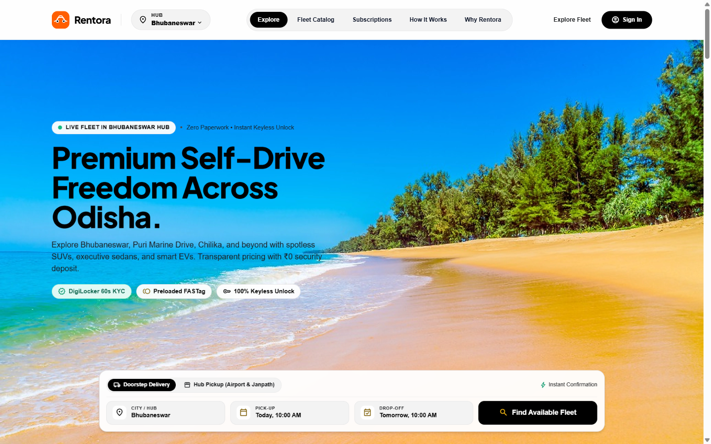
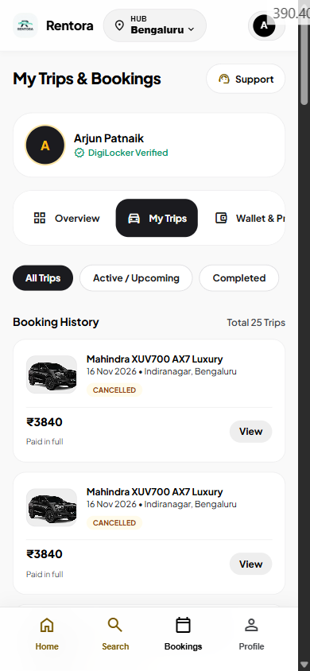
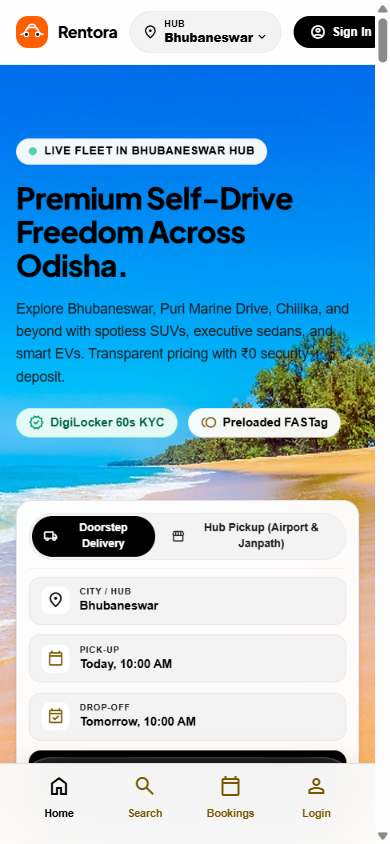

<div align="center">

<!-- 3D Header Banner -->


[](https://rentora-6d1s.onrender.com/)
[](https://pranayakd.in/)
[](https://github.com/PranayaKD/Rentora)
[](https://www.djangoproject.com/)
[](https://www.postgresql.org/)
[](https://github.com/PranayaKD/Rentora)

<br/>

**A production-engineered self-drive car rental platform built for regional fleet logistics across Odisha (Bhubaneswar, Cuttack, Puri, Bhadrak).**  
Features strict double-booking prevention, dynamic weekend/holiday surge pricing, DigiLocker KYC verification, automated FASTag toll reconciliation, SOS dispatch, and multi-gateway checkout (Razorpay & Stripe).

[Explore Live Demo](https://rentora-6d1s.onrender.com/) • [API Endpoints](#-restful-api-endpoints) • [System Architecture](#-system-architecture) • [Test Suite (275 Tests)](#-comprehensive-test-suite)

</div>

---

## 📸 Visual Showcase & Previews

<div align="center">
  <h3>Desktop Command Console & Coastal Hero</h3>
  
</div>

<br/>

<div align="center">
  <table width="100%">
    <tr>
      <td width="65%" align="center">
        <h4>Interactive User Dashboard & Active Bookings</h4>
        
      </td>
      <td width="35%" align="center">
        <h4>Mobile-First Responsive Experience</h4>
        
      </td>
    </tr>
  </table>
</div>

---

## ⚡ Core Engineering Highlights

```
┌─────────────────────────────────────────────────────────────────────────────┐
│                             RENTORA ARCHITECTURE                             │
├───────────────────────┬──────────────────────────┬──────────────────────────┤
│    Pricing Engine     │    Concurrency Guard     │     Indian Mobility      │
│  Base rate + Surge    │  Atomic Overlap Blocks   │  FASTag Toll Disputes    │
│  ₹0 Security Deposit  │  select_for_update() locks│  DigiLocker KYC Checks   │
│  GST 18% Breakdown    │  Zero Double-Bookings    │  Emergency SOS Dispatch  │
└───────────────────────┴──────────────────────────┴──────────────────────────┘
```

- **Double-Booking Elimination**: Strict date-interval overlap verification on both query and database levels using atomic transactions (`select_for_update`) to prevent concurrent race conditions on high-demand vehicles.
- **Dynamic Pricing Engine**: Automated daily rental calculation with 15% weekend surcharge (Fri–Sun), 300 free KM vs. Unlimited KM packages, dynamic extra KM fees, and GST tax invoice generation.
- **Odisha Fleet Hub Integration**: Real-time hub switching between Bhubaneswar (Patia / Airport), Cuttack (Badambadi), Puri (Marine Drive / Grand Road), and Bhadrak (Charampa).
- **Authentication**: Twilio SMS Phone OTP verification with automated profile creation and Google OAuth 2.0 social login.
- **Payment Gateway Orchestration**: Razorpay (UPI, NetBanking, Cards) and Stripe with webhook signature verification.
- **High-Performance Caching**: Redis/in-memory catalog caching (`cache.get('homepage_cars_data')`) with automatic signal-driven cache clearing on model saves.

---

## 🛠️ Complete Tech Stack

| Domain | Technology / Library | Role in Rentora |
| :--- | :--- | :--- |
| **Backend Framework** | **Django 5.2+** / Python 3.11+ | Primary application framework, ORM, and MVC engine |
| **API Layer** | **Django REST Framework (DRF)** | JSON APIs for live search, booking checks, and mobility actions |
| **Primary Database** | **PostgreSQL (Supabase / Render)** | Persistent ACID storage with indexing on lookup and dates |
| **In-Memory Cache** | **Django Cache / LocMemCache** | Sub-10ms response caching for car fleet catalogs |
| **Vector Maps** | **MapLibre GL JS** | High-performance open-source vector maps for hub locations |
| **Payment Gateways** | **Razorpay & Stripe SDKs** | Dual-provider checkout with HMAC webhook verification |
| **Authentication** | **Twilio Verify & Django-Allauth** | SMS OTP passwordless login and Google OAuth SSO |
| **Asset Storage** | **Cloudinary & Whitenoise** | CDN media delivery for vehicles, driver KYC, and toll receipts |
| **Error Monitoring** | **Sentry Python SDK** | Real-time production telemetry and exception reporting |
| **Design System** | **Tailwind CSS + Epilogue Font** | Stitch design tokens, warm cream palette (`#FDFBD6`), ink black |

---

## 🌐 RESTful API Endpoints

Rentora exposes clean, well-tested REST endpoints for web and mobile clients:

| HTTP Method | Endpoint | Description | Auth Required |
| :--- | :--- | :--- | :---: |
| `GET` | `/api/cars/search/` | Live query car catalog by city, seats, price, and fuel | Public |
| `POST` | `/api/booking/check-availability/` | Check car availability for exact date/time window | Public |
| `GET` | `/api/cars/<id>/booked-dates/` | Fetch blocked dates for calendar disabled-state | Public |
| `POST` | `/api/promo/apply/` | Validate and calculate coupon discount savings | Authenticated |
| `POST` | `/api/wishlist/toggle/<id>/` | Add or remove vehicle from saved favorites | Authenticated |
| `POST` | `/api/trip/<booking_id>/toll-dispute/` | Submit cash toll receipt for FASTag refund | Authenticated |
| `POST` | `/api/trip/<booking_id>/sos/` | Trigger emergency roadside assistance with GPS coordinates | Authenticated |
| `POST` | `/api/trip/<booking_id>/extend/` | Request trip extension with automated conflict check | Authenticated |
| `POST` | `/api/trip/<booking_id>/cancel-sla/` | Calculate cancel refund according to policy SLA | Authenticated |
| `POST` | `/api/razorpay/callback/` | Webhook callback with HMAC-SHA256 signature check | Public |

---

## 🧪 Comprehensive Test Suite

Rentora includes **275 deterministic automated tests** testing models, views, APIs, and business workflows:

```bash
$ python manage.py test core accounts admin_panel

Creating test database for alias 'default'...
Found 275 test(s).
System check identified no issues (0 silenced).
...........................................................................
...........................................................................
...........................................................................
...................................................................
----------------------------------------------------------------------
Ran 275 tests in 80.084s

OK
Destroying test database for alias 'default'...
```

### Test Coverage Highlights:
- **Price Calculation Tests**: Standard rates, unlimited KM packages, weekend surge multipliers, and GST math.
- **Overlap & Anti-Double-Booking Tests**: Validates overlapping, touching, and non-overlapping booking date ranges.
- **Cancellation SLA Tests**: 100% refund (>24 hrs), tiered deductions, and no-refund windows.
- **KYC & Security Tests**: Masked Aadhaar/PAN fields, driving license verification workflows, and IDOR protection.
- **API Response Tests**: Status codes, JSON payloads, and unauthenticated permission guards.

---

## 🚀 Local Installation & Setup

```bash
# 1. Clone repository
git clone https://github.com/PranayaKD/Rentora.git
cd Rentora

# 2. Create virtual environment
python -m venv env
source env/bin/activate  # On Windows: .\env\Scripts\activate

# 3. Install dependencies
pip install -r requirements.txt

# 4. Set up environment variables
cp .env.example .env
# Edit .env with your PostgreSQL credentials, Razorpay, Stripe, and Twilio keys

# 5. Run database migrations
python manage.py migrate

# 6. Seed initial Odisha car fleet and hubs
python manage.py loaddata fixtures/initial_fleet.json  # If available or create superuser

# 7. Run test suite to verify installation
python manage.py test

# 8. Start development server
python manage.py runserver
```

Open `http://localhost:8000` to access the application.

---

## 📄 License & Author

Developed by **[PranayaKD](https://pranayakd.in/)** ([Pranaya Kumar Dash](https://github.com/PranayaKD)).  
Portfolio: **[https://pranayakd.in/](https://pranayakd.in/)**  
Licensed under the [MIT License](LICENSE).

<div align="center">
  <sub>⭐ If you find Rentora inspiring or useful for your own Django projects, please star the repository!</sub>
</div>
